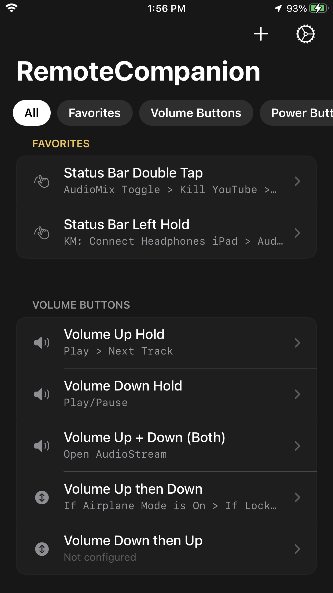
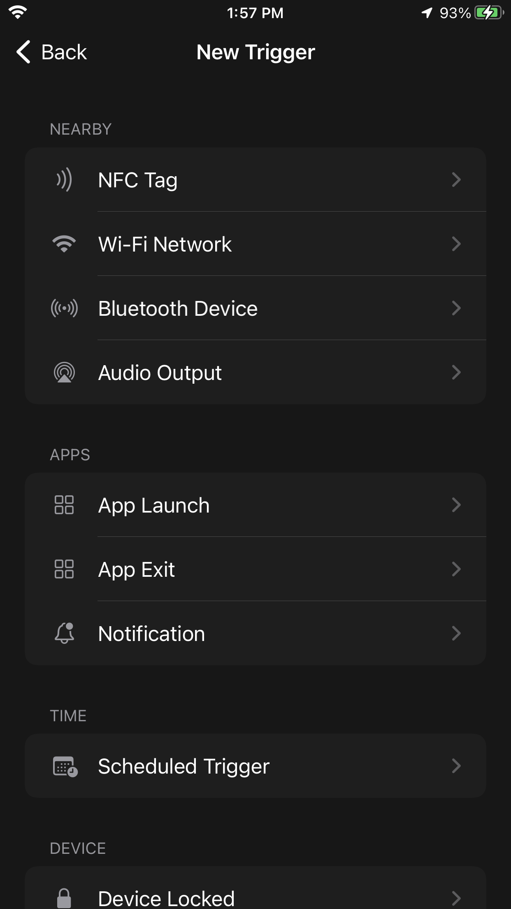
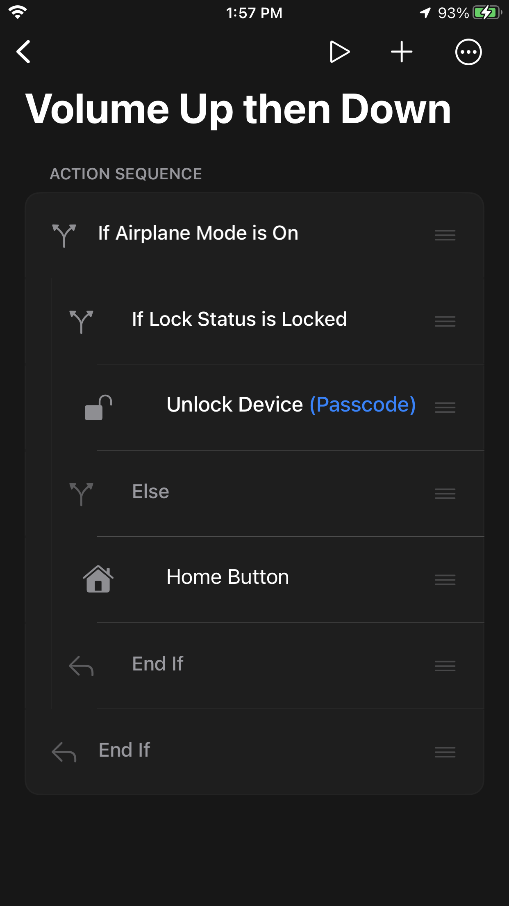
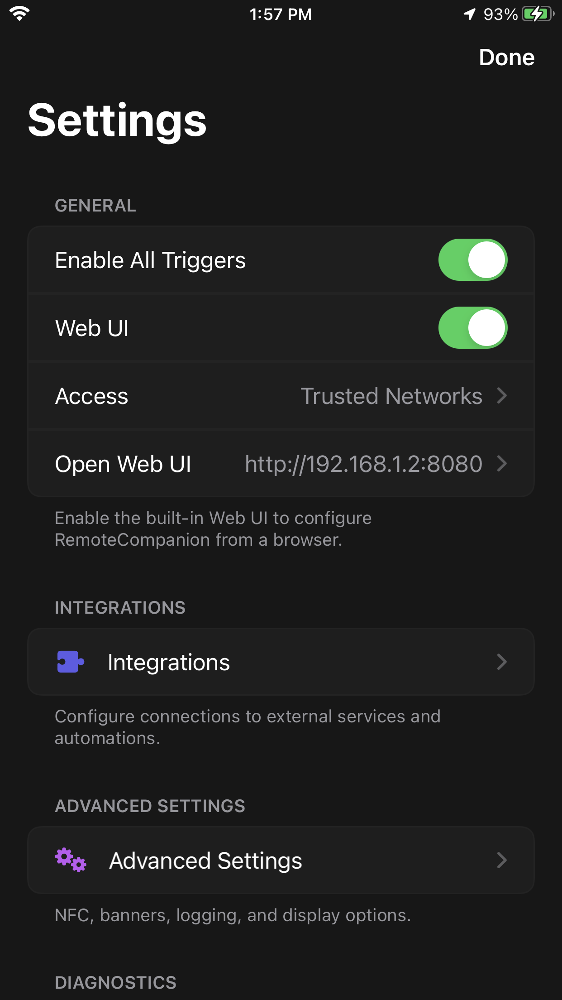
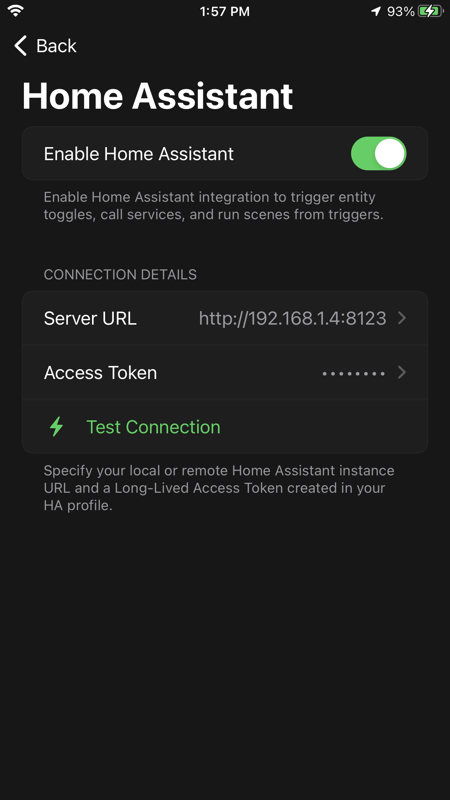
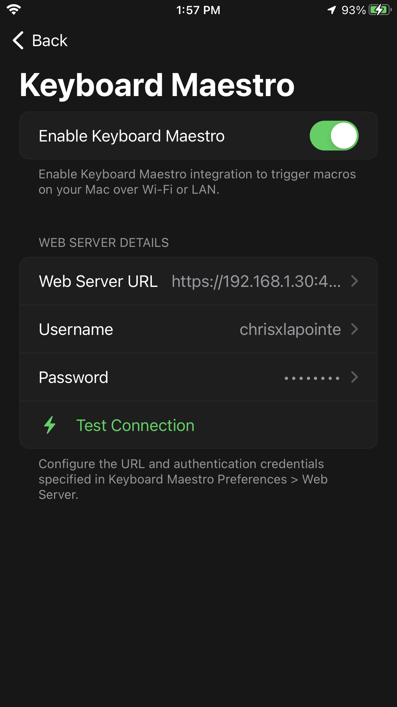

# RemoteCompanion 

RemoteCompanion provides fast, scriptable system control for modern rootless jailbreaks. It lets you bind physical gestures and hardware buttons, or send commands remotely from your computer, to trigger system actions, control media playback, and run custom scripts.

> [!IMPORTANT]
> **What’s New in v4.4.0**
> - **New Triggers**: Rotated to Landscape / Portrait, Find My Sound, Incoming Call / Call Started / Call Ended, Battery Level (1-100%), and Focus on / off for a chosen Focus or any Focus.
> - **Gesture Recorder**: Settings > Gestures records taps, swipes and scrolls, names the recording, and plays it back at 0.5x to 3x with trim, re-record, replace, rename, export and import.
> - **Faster Building**: compact layout with tile grids, trigger icons, copy and paste for actions, search in the New Trigger screen, and a searchable Stop Trigger picker styled like the Triggers screen.
> - **Loops and Waits**: Repeat, Repeat While, Exit Repeat and Wait Until blocks, `{round}` inside a loop, and nesting with If blocks in either order.
> - **Running & History**: see every trigger running now, stop one or all, follow a run step by step, and review past runs with the actions as they ran. Keep 0 to 50 runs per trigger, on iOS and in the Web UI.
> - **Variables**: the Set Variable action saves a value, changes it with math or an RC command, or keeps it for one run. `{name}` in action text becomes its value, a Variable condition compares it, and Settings > Advanced Settings > Variables lists what is saved.
> - **App Quick Action**: pick an app, then one of its registered shortcuts, read live from SpringBoard so the Home Screen menu never has to be opened first.
> - **Excluded Apps**: Settings > Advanced Settings > Options lists every trigger that has actions, grouped like the Triggers page, and sets the apps where each one should stay quiet.
> - **Toasts on the Lock Screen**: toasts show over the lock screen, wait for the next wake when the screen is off, and can wake the screen with the new Wake Screen switch.
> - **Web UI Light Mode**: the Web UI follows system appearance with a full light palette, and the Running sheet covers live runs and recent history.
> - **API Token Gating**: an optional token in Settings > Web UI > Access gates privileged `/api/command` calls (`root`, `sudo`, `exec`).
> - **Two-Finger Slides**: slide up from the bottom bar or down from the status bar with two fingers, each firing its own trigger, with distance-based firing, a widened landing zone, and Control Center suppression mid-gesture.
> - **Lock Scrolling During Gestures**: an off-by-default toggle that keeps lists still while gesturing.

<p align="center">
  <a href="https://saihgupr.github.io/remotecompanion/">Official Website</a> •
  <a href="#features">Features</a> •
  <a href="#web-ui--automations-hub">Web UI Hub</a> •
  <a href="#cli-commands--system-control">CLI Commands</a> •
  <a href="#integrations">Integrations</a> •
  <a href="#installation--setup">Installation</a> •
  <a href="#developer-tools--apis">Developer Tools</a> •
  <a href="#troubleshooting">Troubleshooting</a>
</p>

<p align="center">
  
  
  
  
</p>

## Features
- **Hardware Triggers**: Bind actions to Power/Volume buttons, Home button, Touch ID (Tap/Hold), or the Ringer Switch.
- **Only Unlock Out of Pocket**: an off-by-default option in Settings > Advanced Settings > Options that makes Unlock Device and lock toggle skip unlocking while the proximity sensor is covered, such as in a pocket.
- **New Triggers in 4.4.0**: Rotated to Landscape / Portrait, Find My Sound (with optional silent ping), Incoming Call / Call Started / Call Ended, Battery Level (fires once at 1-100%), and Focus on / off for a chosen Focus or any Focus.
- **Gesture Recorder**: Settings > Gestures records a mix of taps, swipes and scrolls, saves it under a name, and plays it back at 0.5x to 3x. Each recording can be trimmed, re-recorded, replaced, renamed, exported and imported.
- **Two-Finger Slides**: two-finger slide up from the bottom bar and slide down from the status bar are their own triggers, with distance-based firing, a widened landing zone, and an optional Lock Scrolling During Gestures toggle.
- **Compact Layout and Trigger Icons**: Triggers, Select Action and Settings > Banners can each show a grid of tiles instead of a list (Advanced Settings > Layout, list stays default). Button and gesture triggers show a small phone or screen-area icon, app triggers show the app icon, and "Screen Gestures" now reads "Status Bar".
- **Copy and Paste Actions**: select actions in a trigger's ••• menu to copy or delete together, then paste into any trigger. An If block brings its whole block, and the clipboard survives closing the app.
- **Loops and Waits**: Repeat and Repeat While blocks, Exit Repeat and Wait Until, with `{round}` for the current round and nesting inside If blocks.
- **Running and Run History**: see what is running now, stop one run or all, follow a run with the current action highlighted, and keep the last 0 to 50 runs per trigger with the actions as they ran.
- **Stop Trigger Picker**: choose the trigger to stop from a searchable list with icons and sections, instead of one long action sheet.
- **Toasts on the Lock Screen**: toasts show over the lock screen, queue until the next wake when the screen is off, and can wake the screen with the Wake Screen switch.
- **Variables**: the Set Variable action saves a value, `{name}` in action text becomes its value, a Variable condition compares it, and Settings > Advanced Settings > Variables lists saved values.
- **App Quick Action**: pick an app, then one of its registered shortcuts read live from SpringBoard, with same-type shortcuts told apart and stale entries reported instead of run.
- **Excluded Apps**: Settings > Advanced Settings > Options lists every trigger that has actions and sets the apps where each trigger does not fire.
- **Universal Search**: Instantly find triggers, actions, shortcuts, and devices with integrated search bars in every picker.
- **Cross-Version Support**: Supports iOS 14 through iOS 17, with partial iOS 26 support, across Rootless, Rootful, and RootHide environments.
- **Advanced Automation**: Full support for NFC tags, custom Lua scripts (with `objc_call` support), and native Siri integration.
- **iPad Experience**: Native landscape orientation and optimized layouts for iPad power users.
- **Live Discovery**: Discovery-based live lists for nearby AirPlay and Bluetooth hardware.
- **Trigger Favorites**: Mark any trigger as a favorite for instant access at the top of the picker.
- **Web UI Light Mode**: the Web UI follows system appearance with a full light palette, dark theme unchanged.
- **API Token Gating**: optional token in Settings > Web UI > Access (and `rc webui token`) that gates privileged `/api/command` calls such as `root`, `sudo` and `exec`, while safe commands and `/api/trigger/<key>` stay open.
- **True Multitasking**: Concurrent server handling powered by GCD—zero battery drain, zero blocking.

---

## Web UI & Automations Hub

Access the desktop-class automation hub at `http://[DEVICE_IP]:8080` from any computer or tablet on your local network.

<p align="center">
  
</p>

<p align="center">
  
  
</p>

> [!TIP]
> **To Enable**: Toggle **Web UI** in the RemoteCompanion Settings (Gear icon) or use the command `rc webui on`.

### Key Features
- **Visual Workflow Editor**: Build complex action sequences with an intuitive drag-and-drop interface.
- **Live Device Discovery**: Dynamically search and select installed Apps, nearby Bluetooth hardware, and Wi-Fi networks using integrated search bars.
- **Remote Testing**: Trigger actions and troubleshoot sequences directly from your browser with live execution buttons.
- **One-Tap API Integration**: Every trigger has a dedicated **Copy API Link** button providing a direct URL to fire that trigger from any network-connected hardware or custom scripts.
- **API Link Copying**: In the Web UI, you can swipe any trigger and tap the **Copy** icon to instantly get the full API URL (including your device's IP).
- **Device Diagnostics & Health Dashboard**: Native iOS-styled inset grouped dashboard monitoring battery, storage, RAM, thermal state, uptime, and quick maintenance actions (Respring, UICache, Flush DNS, Clear Logs).
- **Negligible Battery Impact**: The Web UI server is extremely efficient, consuming zero CPU cycles when idle. It uses a background thread with a blocking `accept()` loop that sits dormant until a connection is made.
- **Configuration Management**: Import and export your entire trigger database for easy backups and migration between devices.
- **Running and History**: A Running sheet lists live runs with Stop and Stop All, plus recent runs and the actions each one took.

---

## CLI Commands & System Control

### Media, Sound & Volume
- `rc play` / `rc pause` / `rc playpause` / `rc next` / `rc prev` - Control media playback.
- `rc volume 0-100` - Set volume level.
- `rc volume up [N]` / `rc volume down [N]` - Step volume up or down by N percent (default is 1 native step) and return the resulting volume percentage (e.g. `Volume: 45%`).
- `rc mute [on|off|toggle|status]` - Control media mute state.
- `rc ringer [silent|ring|toggle]` - Control Silent Mode / Ringer Switch state.
- `rc ringer volume 0-100` - Set ringer volume percentage.
- `rc haptics [always|silent-only|ring-only|never]` - Set system haptics mode.
- `rc anc [on|off|transparency]` - Control headphone ANC (requires Sonitus).

### Device Control
- `rc lock` - Lock the screen.
- `rc unlock [pin]` - Wakes and unlocks the device (or wakes screen if pin omitted). With Settings > Advanced Settings > Options > Only Unlock Out of Pocket on, it skips the unlock while the proximity sensor is covered.
- `rc lock-toggle [pin]` / `rc lock toggle [pin]` - Toggle screen lock/unlock state (unlocks with optional passcode if locked).
- `rc autolock [toggle|30s|1m|2m|3m|4m|5m|never|off]` / `rc display sleep [duration]` / `rc display time off` - Configure display sleep / auto-lock timeout.
- `rc button [power|lock|home|volup|voldown|mute]` - Simulate physical button presses.
- `rc brightness 0-100` - Set screen brightness.
- `rc flashlight [on|off|toggle]` - Control the torch.
- `rc rotate [lock|unlock|toggle]` - Orientation lock control.
- `rc appearance [dark|light|toggle]` - Set light/dark appearance.
- `rc dnd [on|off|toggle]` - Toggle Do Not Disturb.
- `rc low power mode [on|off|toggle]` - Toggle battery saver.
- `rc airplane [on|off|toggle]` - Control Airplane Mode.
- `rc haptic` / `rc screenshot` - Haptic feedback / Screenshot.
- `rc screenrecord [toggle|start|stop|status]` - Native SpringBoard screen recording control.
- `rc snapper [open|freeze|instant|close]` - Direct Snapper 2 / Snapper 3 overlay trigger.
- `rc control-center` - Opens the system Control Center.
- `rc switcher` - Opens/toggles the App Switcher.
- `rc previous app` / `rc last app` - Returns to the previously active application.
- `rc vibration [silent-toggle|ring-toggle]` - System "Vibrate on Silent/Ring" settings.

### Apps, URLs & Shortcuts
- `rc nav <triggers|settings|ha|km|mqtt|add|advanced|testkit>` - Navigate directly to any RemoteCompanion panel or trigger editor (supports `remotecompanion://` deep linking URL scheme).
- `rc open <alias|bundleID>` (e.g., `youtube`, `spotify`, `settings`, `messages`, `home`, `photos`, `camera`, `clock`, `maps`, `calendar`, `weather`, `notes`, `reminders`, `appstore`, `mail`, `music`, `phone`, `stocks`, `calculator`, `tv`, `wallet`, `facetime`, `files`).
- `rc kill <alias|bundleID>` - Force close an app.
- `rc kill current` - Force close the currently focused app.
- `rc shortcut -r "Name" [-i] [-p "Input"]` - Run any Shortcut (`-i`: silently, without the Shortcuts progress on screen).
- `rc url "https://google.com"` - Open any link (with smart unlock).
- `rc spotify <playlist|album|artist> <id>` - Play specific Spotify content.
- `rc spotify play` - Resume Spotify playback.

### Connectivity
- `rc wifi [on|off|toggle]` / `rc cellular [on|off|toggle]` / `rc bluetooth [on|off|toggle]` / `rc location [on|off|toggle]`
- `rc bluetooth [connect|disconnect] <name>` - Manage paired devices.
- `rc airplay list` - See speakers and their UIDs.
- `rc airplay connect <name|UID>` - Stream audio to an AirPlay receiver.
- `rc airplay disconnect` - Stop AirPlay streaming.

### Text & Notifications
- `rc type "Text"` - Type text (supports symbols).
- `rc paste "Text"` - Paste into clipboard.
- `rc toast "Title" ["Subtitle"] ["SF Symbol"]` - Display a HUD toast notification. *(Use single quotes if passing special characters like `!` to prevent shell history expansion).*
- `rc key <hex>` - Specific keyboard keys (e.g., `0x04` for 'A', `0x28` for Enter).
- `rc log` - View the RemoteCompanion server logs.

### Status & Queries
- `rc volume` - Returns current volume %.
- `rc app` - Returns foreground app bundle ID.
- `rc is-locked` / `rc lock status` - Returns `locked` or `unlocked`.
- `rc player status` - Returns detailed playback state (`Playing`, `Paused`, `Stopped`, etc.).
- `rc mute status` - Returns current media mute state and level.
- `rc logs` - Stream live debug logs from the device (tail `/tmp/remotecommand.log`).
- `rc vibration [silent-status|ring-status]` - Check current system vibration state.
- `rc orientation status` - Returns `PORTRAIT` or `LANDSCAPE`.
- `rc rotate status` - Returns orientation lock state.
- `rc dnd status` - Returns Do Not Disturb state.
- `rc lpm status` - Returns Low Power Mode state.
- `rc airplane status` - Returns Airplane Mode state.
- `rc wifi status` / `rc cellular status` / `rc bt status` / `rc location status` - Returns connectivity and GPS states.
- `rc flashlight status` - Returns torch state.
- `rc proximity` - Returns `near` or `far`. *(Note: iOS powers off the sensor when the screen is asleep. To test manually while the screen is awake, run `rc proximity on` to force it active, then `rc proximity off` to disable it.)*

### System & Diagnostics
- `rc uicache` - Refresh the icon cache.
- `rc respring` - Restart SpringBoard.
- `rc safemode` - Enter Safe Mode (tweaks disabled).
- `rc ldrestart` - Soft-reboot the device.
- `rc userspace-reboot` - Restart userspace.
- `rc webui [on|off|status]` - Enable, disable, or check the status of the Web UI server.
- `rc webui access [any|networks|local]` - Limit where the Web UI can be reached from (default `any`).
- `rc webui wifi` - Show the current Wi-Fi network name (used for Trusted Networks access).
- `rc focus [on|toggle] <name>` / `rc focus off` / `rc focus status` - Set or query a Focus mode.
- `rc stop trigger <key>` - Cancel another trigger's running sequence.
- `rc button triggers pause [minutes]` / `rc button triggers resume` - Temporarily return buttons and gestures to stock behavior.
- `rc nfc scanner [pause|resume|toggle]` - Pause or resume NFC tag scanning.

<details>
<summary><b>Hardware Triggers Reference (Tweak App)</b></summary>

Configure these in the `RemoteCompanion` app for custom action sequences. Tip: **Long-press** any trigger in the app to instantly test and run its assigned actions.

- **Hardware Buttons**:
  - **Power**: Double-tap, Long-press, **Triple/Quadruple click**, or **Power + Volume Up/Down** combos.
  - **Volume**: Long hold Up/Down (0.3s), **Volume Up + Down** combo, or sequential **Volume Up then Down** / **Volume Down then Up** one-handed pocket gestures.
  - **Home**: Double-tap (Touch ID), Double, Triple, or Quadruple click, **Hold**, or **Home + Power** combo.
  - **CarPlay**: Connected / Disconnected triggers.
  - **Apple Watch**: Ping iPhone (tap or hold Ping on a paired Watch).
- **Touch ID Sensor**: **Single Tap** and **Hold (Rest Finger)** triggers.
- **NFC Triggers**: Scan physical NFC tags to run actions on screen wake (Optional toggle in Settings).
- **Ringer Switch**: Mute, Unmute, or Toggle triggers.
- **Gestures**: 
  - **Status Bar**: Hold (Left/Center/Right), Double-Tap, Swipe Left/Right, or a two-finger slide down.
  - **Edge Gestures**: Vertical swipe on left/right edges.
  - **Bottom Bar Gestures**: Swipe Left/Right, **3-Zone Swipe Up** (Left 33%, Center 34%, Right 33%), or a two-finger slide up.
- **Motion Gestures**:
  - **Shake**: Fire actions when the device is physically shaken.
- **System Events**:
  - **Scheduled**: Run actions at specific times (e.g., Daily at 4 PM).
  - **WiFi/Bluetooth**: Trigger actions on network or device connectivity.
  - **App Launch**: Fire actions when a specific app is opened.
  - **App Exit**: Fire actions when a specific app is switched away from.
  - **Audio Output**: Fire actions when an AirPlay, Bluetooth, or iPhone output is set or unset.
  - **Calls**: Incoming Call, Call Started and Call Ended, for Phone, FaceTime and other calling apps.
  - **Battery Level**: Fire once when the battery drops to or rises to a chosen level from 1 to 100%.
  - **Focus**: Run when a chosen Focus, or any Focus, turns on or off.
  - **Find My Sound**: Run when Play Sound is sent to the phone from Find My or iCloud.com.
  - **Rotation**: Rotated to Landscape / Portrait, after a half-second settle.

</details>

<details>
<summary><b>Blacklist (App Exclusion)</b></summary>

RemoteCompanion includes a blacklist system to prevent hardware triggers and gestures from firing while specific apps are in the foreground. This is useful for avoiding conflicts with apps that use the same buttons or gestures (e.g. games, camera apps).

Use the `rc blacklist` command to manage the list:
- `rc blacklist list`: View currently blacklisted bundle IDs.
- `rc blacklist add <bundleID>`: Add an app to the blacklist (e.g. `rc blacklist add com.apple.camera`).
- `rc blacklist remove <bundleID>`: Remove an app from the blacklist.
- `rc blacklist reset`: Reset the blacklist to the factory defaults.

</details>

<details>
<summary><b>Conditional Actions & Proximity Rules</b></summary>

Combine status queries with actions for smart automation:
- **Pocket/Proximity-Awareness**: `If Proximity Sensor is Near (Covered / Pocket)` -> `Skip Action` (perfect for preventing accidental pocket flashlight activation).
- **Orientation-Awareness**: `If Orientation is Landscape` -> `Flashlight Toggle`.
- **Bluetooth/Wi-Fi State**: `If Wi-Fi is OFF` -> `Wi-Fi ON`.
- **Time of Day**: `If Time is Between 22:00 and 07:00` -> `Do Not Disturb ON`.
- **Variables**: `If Variable score is above 10` -> `Toast "High score"` (set with the Set Variable action, used as `{score}` in action text).

> [!NOTE]
> **Proximity Sensor Cooldown**: To conserve battery, the proximity sensor is only powered on dynamically during button holds and is shut off immediately on release. Due to iOS kernel-level hardware power-gating, rapid consecutive clicks (within ~5 seconds) may temporarily bypass proximity evaluation until the sensor's hardware cooldown window resets.

</details>

<details>
<summary><b>Integrations CLI Commands (HA, Keyboard Maestro, MQTT)</b></summary>

### Home Assistant
- `rc ha toggle <entity_id>` - Toggle a Home Assistant light, switch, or entity (e.g. `rc ha toggle light.bedroom_lights`).
- `rc ha turn_on <entity_id>` / `rc ha turn_off <entity_id>` - Turn on or off a Home Assistant entity.
- `rc ha call <domain.service> <entity_id>` - Call any Home Assistant service (e.g. `rc ha call light.turn_on light.bedroom_lights` or `rc ha call scene.turn_on scene.movie_night`).
- `rc ha raw <domain.service> <json_payload>` - Send custom JSON payloads to any Home Assistant service endpoint (e.g. `rc ha raw light.turn_on '{"entity_id":"light.bedroom","brightness":200}'`).

### Keyboard Maestro
- `rc km trigger <macro_name_or_uuid> [value]` - Trigger a Keyboard Maestro macro on your Mac by Name or UUID (e.g. `rc km trigger "Sleep Display"` or `rc km trigger 12345678-ABCD-EF01-2345-6789ABCDEF01 "MyParam"`).
- `rc km url <web_trigger_url>` - Trigger a full Keyboard Maestro Web Server action URL (e.g. `rc km url "http://192.168.1.50:4490/action.html?macro=Sleep%20Display"`).

### MQTT
- `rc mqtt pub <topic> [payload]` / `rc mqtt publish <topic> [payload]` - Publish messages to an MQTT broker (e.g. `rc mqtt pub "home/livingroom/light/set" "TOGGLE"` or `rc mqtt pub "remotecompanion/device/ping"`).

</details>

---

## Integrations

<details>
<summary><b>Home Assistant Integration</b></summary>

### 1. Controlling Home Assistant from RemoteCompanion

Enable two-way automation between your iOS device and Home Assistant:

1. In the Web UI or iOS App, go to **Settings** &rarr; **Integrations** &rarr; **Home Assistant**.
2. Toggle on **Enable Home Assistant**.
3. Enter your **Server URL** (e.g., `http://192.168.1.100:8123`) and a **Long-Lived Access Token** (generated under your Home Assistant Profile &rarr; Long-Lived Access Tokens).
4. Click **Test Connection** to verify setup.

<p align="center">
  
</p>

Once configured:
- Use **Control Home Assistant Entity…** in any trigger sequence to search and select entities (lights, switches, scenes, scripts, automations, locks) with live state badges and quick action options (Toggle, Turn On, Turn Off), or enter custom commands manually.
- Execute HA commands directly via CLI: `rc ha toggle light.bedroom_lights`, `rc ha call light.turn_on light.bedroom_lights`, or `rc ha raw light.turn_on '{"entity_id":"light.bedroom","brightness":200}'`.

### 2. Controlling RemoteCompanion from Home Assistant

Control your iPhone or iPad directly from Home Assistant via SSH `shell_command`:

```yaml
shell_command:
  iphone_remote: >
    ssh -o "StrictHostKeyChecking=no" mobile@YOUR_IPHONE_IP "rc {{ cmd }}"
```
Then call it in automations or scripts:

```yaml
service: shell_command.iphone_remote
data:
  cmd: 'play'
```

Alternatively, call the Automations API endpoint: `http://[DEVICE_IP]:8080/api/command?cmd=lock`.

</details>

<details>
<summary><b>Keyboard Maestro Integration</b></summary>

### Controlling Keyboard Maestro from RemoteCompanion

Trigger macros on your Mac directly from iPhone hardware gestures, buttons, NFC tags, or scripts:

1. In Keyboard Maestro on your Mac, open **Preferences** &rarr; **Web Server** and check **Enable Web Server**.
2. Note your Mac's IP address and Port (default: `4490`), and set a Username/Password if desired.
3. In the RemoteCompanion Web UI or iOS App, go to **Settings** &rarr; **Integrations** &rarr; **Keyboard Maestro**.
4. Toggle on **Enable Keyboard Maestro**.
5. Enter your **Web Server URL** (e.g., `http://192.168.1.50:4490`) and optional **Username** and **Password** (supports HTTP Basic Authentication).
6. Click **Test Connection** to verify connectivity.

<p align="center">
  
</p>

Once configured:
- **Visual Macro Picker**: Open **Keyboard Maestro: Trigger Macro…** in the action picker to browse and search all macros categorized by group, with instant live filtering and parameter selection.
- **Parameter Support**: Tapping or long-pressing any KM action in an action sequence allows you to edit or remove its `%TriggerValue%` parameter, test execution immediately, or switch to a different macro.
- **CLI & Scripts**: Execute KM commands directly via CLI: `rc km trigger "Sleep Display"` or `rc km "My Macro Name" "Optional Value"`.

</details>

<details>
<summary><b>MQTT Integration (Pub / Sub)</b></summary>

### 1. Publishing to MQTT from RemoteCompanion

Connect directly to local or cloud MQTT brokers (e.g. Mosquitto, EMQX, Home Assistant Mosquitto add-on) with zero external dependencies and near-zero battery impact:

1. In the RemoteCompanion Web UI or iOS App, go to **Settings** &rarr; **Integrations** &rarr; **MQTT**.
2. Toggle on **Enable MQTT**.
3. Enter your **Broker Host** (e.g. `192.168.1.50` or `homeassistant.local`), **Port** (`1883`), **Client ID**, and optional **Username** & **Password**.
4. Set an optional **Default Topic Prefix** (e.g. `home/bedroom` or `remotecompanion`).
5. Tap **Test Connection** to confirm broker communication.

Once configured:
- **Action Picker**: Select **MQTT: Publish Topic…** to assign publish actions with customizable topics and payloads (strings, numbers, or JSON) to any gesture, hardware button, or scheduled trigger.
- **CLI**: Publish directly from scripts or terminal using `rc mqtt pub <topic> [payload]`.

### 2. Inbound MQTT Subscription Triggers

Subscribe to topics on your broker and execute local iOS action sequences whenever an MQTT message arrives:

1. In the iOS App or Web UI, tap **`+`** (New Trigger) &rarr; **MQTT Topic**.
2. Enter the **MQTT Topic** to monitor (e.g. `home/alerts/phone`, `remotecompanion/wake`, or wildcards like `sensors/+/state`).
3. (Optional) Enter an exact **Payload Match** (e.g. `ON`, `RING`), or leave empty to trigger on any message.
4. Add your desired action sequence (Haptic alert, audio alarm, flashlight toggle, TTS speech, app launch, etc.).

The background listener daemon runs inside SpringBoard with automatic 60s keep-alives, auto-reconnect, and shuts down whenever no MQTT triggers are active to ensure zero idle battery drain.

</details>

---

## Installation & Setup

### 1. Requirements
- A **Jailbroken Device** running iOS 14 through iOS 17. iOS 26 is partially supported and still needs broader testing.
- Compatible with **Rootless**, **Rootful**, and **RootHide** jailbreak environments (Dopamine, Palera1n, unc0ver, Taurine, XinaA15, NathanLR).

### 2. Installation

#### Option 1: Package Manager (Recommended)
Install from **[Havoc](https://havoc.app/package/remotecompanion)** without adding a source, or add the project repo `https://saihgupr.github.io/remotecompanion` to Sileo or Zebra:
- [Add to Sileo](sileo://source/https://saihgupr.github.io/remotecompanion)
- [Add to Zebra](zbra://sources/add/https://saihgupr.github.io/remotecompanion)
- [Get it on Havoc](https://havoc.app/package/remotecompanion)

#### Option 2: Manual .deb Installation
Download the latest `.deb` package from [Releases](https://github.com/saihgupr/remotecompanion/releases) and install via Sileo, Filza, or `dpkg -i`.

#### Option 3: Build from Source
Ensure you have [Theos](https://theos.dev) installed.
```bash
git clone https://github.com/saihgupr/remotecompanion.git
cd remotecompanion
./build.sh
```
By default, `./build.sh` builds the unified rootless `.deb` package (companion app, web UI, CLI, and tweak). You can also pass `--rootful`, `--roothide`, `--all`, or `--clean`.


### 3. Usage Methods

#### Method A: Computer Terminal via `rc` Script (Easiest)
Control your iPhone from your computer terminal using the included `rc` client script. It communicates over SSH into a local UNIX socket on the device:

1. Copy the script to your computer's PATH:
   ```bash
   chmod +x rc
   sudo cp rc /usr/local/bin/rc
   ```
2. Set your iPhone's IP or hostname in your shell profile (e.g., `~/.zshrc`):
   ```bash
   export RC_IPHONE_IP=iphone.local
   ```
3. Run any command:
   ```bash
   rc play
   rc volume 50
   rc flashlight toggle
   ```

#### Method B: Direct SSH
Run commands directly on the iPhone over SSH:
```bash
ssh mobile@iphone.local "rc lock"
ssh mobile@iphone.local "rc volume 50"
ssh mobile@iphone.local "rc respring"
```

#### Method C: iOS Shortcuts
Trigger RemoteCompanion commands inside iOS Shortcuts automations:
- **Native SSH Action**: Add the **Run script over SSH** action in Shortcuts (`Host: localhost`, `Port: 22`, `User: mobile`, `Script: rc flashlight toggle`).
- **Powercuts Action**: If you have **Powercuts** installed, add **Run shell command** with `rc open Music`.

---

## Developer Tools & APIs

### Add-ons

Another app or tweak can add its own actions, conditions, triggers and banners to RemoteCompanion with one JSON file in its package, without any change to RemoteCompanion. Start with the guide, [ADDONS-GUIDE.md](ADDONS-GUIDE.md); every key is in the reference, [ADDONS.md](ADDONS.md). [`tools/addon-lint.py`](tools/addon-lint.py) checks a file on the Mac before it's packaged.

<details>
<summary><b>Lua Scripting & Objective-C Bridge</b></summary>

RemoteCompanion introduces a powerful Lua bridge that allows you to execute arbitrary Lua scripts within the tweak's process. The exact same context is available whether you run a script file from the CLI or paste code into the "Lua Script" action in the app.

### How to Run
- **From CLI**: `rc lua /path/to/script.lua`
- **From UI**: Add Action → System → **Custom Lua Script**. Paste your code directly into the prompt.

### API Bindings

| Function | Description |
| :--- | :--- |
| `log(msg)` | Writes to the system log (syslog). |
| `delay(seconds)` | Pauses execution for `seconds`. |
| `haptic()` | Triggers a standard haptic feedback. |
| `openURL(url)` | Opens a URL scheme (e.g. `prefs:root=General`). |
| `dlopen(path)` | Loads a dynamic library. Returns `true` on success. |
| `objc_call(target, selector, args...)` | Calls an Objective-C method. `target` can be a class name string or an instance. |

### Examples

**Trigger Haptic and Log**
```lua
log("Starting haptic engine...")
haptic()
delay(0.2)
haptic()
log("Finished haptic feedback.")
```

**Call a Class Method (get a shared instance)**
```lua
-- objc_call(className, selector) returns an instance
local device = objc_call("UIDevice", "currentDevice")
if device then
    objc_call(device, "setBatteryMonitoringEnabled:", true)
    local level = objc_call(device, "batteryLevel")
    log("Battery: " .. tostring(level * 100) .. "%")
end
```

> [!NOTE]
> `objc_call` works like standard Objective-C messaging — it does not scan memory for existing instances. To call an instance method, you first need to obtain the instance via a class-level accessor (e.g. `sharedInstance`, `currentDevice`) or by allocating a new one with `alloc`/`init`.

</details>

<details>
<summary><b>Assistant Sequence Builder</b></summary>

Build custom action sequences, then paste the result directly into the app using **Import**.

**[→ Full guide](SCRIPTING.md)**

Example prompt:
```
Read this guide: https://github.com/saihgupr/remotecompanion/blob/main/SCRIPTING.md

Using the action format defined there, create a RemoteCompanion sequence that:
pause music, wait 2 seconds, take a screenshot, then play music again

Return ONLY the raw JSON array. No explanation, no markdown, no code fences.
```

Copy the JSON output → open your trigger → tap **⋯** → **Import** → paste → **Import**.

</details>

<details>
<summary><b>Automations API & HTTP REST Server</b></summary>

Control your device from any network-connected hardware via simple HTTP calls.

> [!IMPORTANT]
> The **Web UI** toggle must be enabled in the RemoteCompanion settings (or via `rc webui on`) for the HTTP server to be active.

**1. Discover Commands & Triggers:**
Get a list of all supported system commands or your custom automation triggers:
- Commands: `http://[device_ip]:8080/api/commands`
- Triggers: `http://[device_ip]:8080/api/triggers`

**2. Execute a System Command:**
Send command strings via `GET` or `POST`:
- **Example (GET)**: `http://[device_ip]:8080/api/command?cmd=play`
- **Example (POST)**: `curl -X POST "http://[device_ip]:8080/api/command" -d "haptic"`

If an API token is set in Settings > Web UI > Access, privileged commands (`root`, `sudo`, `exec`) need it as `Authorization: Bearer <TOKEN>`, `X-API-Key: <TOKEN>`, `?token=` or `?key=`.

**3. Fire an Automation Trigger:**
Execution URLs for your specific triggers:
- **Example**: `http://[device_ip]:8080/api/trigger/trigger_1`

#### Performance & Implementation
* **Speed**: The HTTP API is significantly faster than SSH (~0.1s faster) by skipping the heavy SSH handshake.
* **Efficiency**: The Web UI server sits in a dormant `accept()` loop, consuming **zero CPU cycles** when idle.

</details>

<details>
<summary><b>Pausing Button Triggers</b></summary>

The **Button Triggers** action pauses the hardware button, Touch ID, ringer switch and screen gesture triggers for 15 minutes, an hour, or until resumed. While paused those buttons and gestures work as without RemoteCompanion; event triggers (NFC tags, Wi-Fi, Bluetooth, schedules, notifications, apps, add-ons) still run. The app shows the pause above its title, with Resume. A paused button can't resume itself, so resume from the app, an NFC tag or another event trigger, the Web UI or a shortcut (`button triggers resume`).

Commands: `button triggers pause [minutes]`, `button triggers resume`, and `button triggers` for the state.

A tweak that needs the buttons to itself for a while (an alarm, for one) can pause them the same way by setting the state of the Darwin notification `com.pizzaman.rc.pause_triggers` to 1, and back to 0 when it's done:

```objc
int token;
notify_register_check("com.pizzaman.rc.pause_triggers", &token);
notify_set_state(token, 1);   // pause; 0 resumes
notify_post("com.pizzaman.rc.pause_triggers");
```

A pause from a tweak left on for 4 hours ends by itself.

</details>

---

## Security

RemoteCompanion implements several measures to ensure your device remains secure:

- **Local Execution**: Local apps and the `rc` CLI communicate securely via a local UNIX socket file, ensuring zero network exposure.
- **Web UI & Automations API**: When enabled, the Automations Hub server transmits data in **plain-text** over your local network. Privileged `/api/command` calls (`root`, `sudo`, `exec`) can be gated behind an optional API token in Settings > Web UI > Access (`rc webui token`), while safe commands and `/api/trigger/<key>` stay open. It is **highly recommended** to only enable the Web UI on trusted, private networks.

---

<details id="troubleshooting">
<summary><h2>Troubleshooting</h2></summary>

### Apple Pay Issues
If you experience the "Updating Cards" screen or other conflicts with Apple Pay when waking your device, you can disable the background NFC scanning feature.
1. Go to the **Settings** tab (gear icon).
2. Toggle off **NFC Scanning**.

This ensures the tweak does not attempt to access the NFC controller on wake, resolving conflicts with system services.

### iOS 14 Architecture Compatibility
RemoteCompanion ships as fat universal binaries containing both `arm64` and `arm64e` slices:
- **A12 and newer (iPhone XS, 11, 12, etc.)**: Runs the native `arm64e` slice across iOS 14, 15, and 16+. On iOS 14, binaries are compiled targeting iOS 14.0 (`TARGET := iphone:clang:latest:14.0`) to match the iOS 14+ `arm64e` ABI v2 standard.
- **A11 and older (iPhone 8/X, iPad Air 2, etc.)**: Runs the standard `arm64` slice natively on iOS 14–16+.
- **Troubleshooting**: If compiling from source or experiencing Safe Mode on iOS 14, ensure your Theos target deployment is explicitly set to `14.0` and that the installed dylibs retain both slices (`lipo -archs "/Library/MobileSubstrate/DynamicLibraries/RemoteCommand.dylib"`, prefixed with `/var/jb/` on rootless).

</details>

---

## Support & Feedback

If you encounter any issues, bugs, or have feature requests, please [open an issue on GitHub](https://github.com/saihgupr/remotecompanion/issues).

RemoteCompanion is open-source and free. If you find it useful, consider giving it a star on GitHub or making a donation to support development!

[](https://ko-fi.com/saihgupr)
